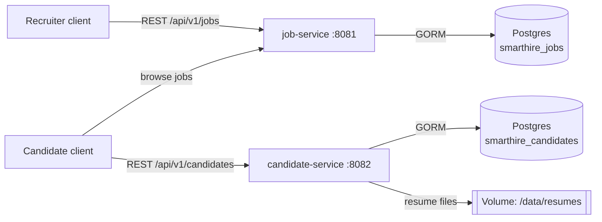

# SmartHire

Backend for **SmartHire**, a workforce orchestration and recruitment platform: job postings, candidate profiles, hiring workflows, and (in later weeks) event-driven processing and analytics.

This is a 3-week learning build. Each week adds a layer:

| Week | Focus | Status |
|------|-------|--------|
| 1 | Foundation: service structure, DB schema, Job & Candidate APIs, local env | ✅ done |
| 2 | Application workflow (duplicates, eligibility, tracking) + Temporal publishing workflow | ⏳ |
| 3 | Kafka events, background workers, observability (OTel, Prometheus, Jaeger) | ⏳ |

## Architecture (Week 1)



- **Two microservices**, each owning its database (database-per-service). They do not call each other in Week 1.
- **Layering inside each service:** `handler` (Gin, HTTP only) → `service` (business rules, transactions, audit) → `repository` (GORM/SQL).
- **Job lifecycle:** `draft → published → closed → archived` (`draft → archived` also allowed). Week 2 inserts `processing` between draft and published, driven by Temporal.

More detail: [docs/architecture.md](docs/architecture.md) · decisions: [docs/adr/](docs/adr/) · what each tool is and why: [docs/LEARNING-week1.md](docs/LEARNING-week1.md).

## Repository layout

```
services/
  job-service/
    cmd/main.go                 # wiring + startup
    internal/
      domain/                   # entities, state machine, publish rules
      repository/               # GORM queries, optimistic locking
      service/                  # use cases, transactions, audit trail
      handler/                  # Gin routes, request DTOs, validation
      migrations/               # embedded SQL migrations
  candidate-service/            # same layout + internal/storage (resume files)
pkg/                            # shared libs: apperr, config, database, httpx, logger, middleware, server
deployments/                    # Dockerfile (multi-stage, distroless) + Postgres init
api/                            # runnable .http request collections
docs/                           # architecture, ADRs, OpenAPI, learning notes
```

## Setup

**Prerequisites:** Go 1.25+, Docker with Compose v2, `make`.
Optional: VS Code **REST Client** extension (or Bruno/Postman) for the `api/*.http` files; TablePlus/DBeaver for browsing the DB; `golangci-lint`.

```bash
make up          # build images, start postgres + both services, wait until healthy
make ps          # status
make logs        # follow JSON logs
make test        # unit tests with -race
make down        # stop (keeps data)
make reset       # stop and delete all data volumes
```

Check it works:

```bash
curl localhost:8081/readyz   # {"postgres":"ok","status":"ready"}
curl localhost:8082/readyz
```

Then open [api/jobs.http](api/jobs.http) and [api/candidates.http](api/candidates.http) and run the requests top to bottom.

**Run a service on the host** (faster edit-run loop): `make db`, then `make run-jobs` or `make run-candidates`. Default config targets `localhost:5432`.

### Configuration (env vars)

| Variable | Default | Notes |
|----------|---------|-------|
| `HTTP_ADDR` | `:8081` / `:8082` | listen address |
| `DB_HOST` / `DB_PORT` | `localhost` / `5432` | |
| `DB_USER` / `DB_PASSWORD` | `smarthire` / `smarthire` | local-dev only |
| `DB_NAME` | `smarthire_jobs` / `smarthire_candidates` | |
| `DB_MAX_OPEN_CONNS` / `DB_MAX_IDLE_CONNS` | `25` / `10` | connection pool |
| `RESUME_STORAGE_DIR` | `./data/resumes` | candidate-service only |
| `LOG_LEVEL` | `info` | `debug`, `info`, `warn`, `error` |
| `SHUTDOWN_TIMEOUT` | `15s` | graceful drain time |

Compose reads overrides from a git-ignored `.env` file (e.g. `POSTGRES_PORT=5433` if 5432 is taken).

> The default credentials are for local development only. Real deployments must inject secrets from a secrets manager, never from files in the repo.

## API overview

Full spec: [docs/api/openapi.yaml](docs/api/openapi.yaml) (paste into https://editor.swagger.io or open with an OpenAPI viewer).

**job-service** `http://localhost:8081/api/v1`

| Method | Path | Purpose |
|--------|------|---------|
| POST | `/jobs` | create draft job (optional inline requirements/stages) |
| GET | `/jobs?status=&recruiter_id=&location=&q=&limit=&offset=` | list / search |
| GET | `/jobs/:id` | job with requirements and stages |
| PATCH | `/jobs/:id` | partial update, requires `version` |
| DELETE | `/jobs/:id` | soft delete (not while published) |
| PUT | `/jobs/:id/requirements` | replace requirements |
| PUT | `/jobs/:id/stages` | replace hiring pipeline |
| POST | `/jobs/:id/publish` · `/close` · `/archive` | lifecycle transitions |
| GET | `/jobs/:id/audit` | audit trail |

**candidate-service** `http://localhost:8082/api/v1`

| Method | Path | Purpose |
|--------|------|---------|
| POST | `/candidates` | register (email unique, case-insensitive) |
| GET | `/candidates?skill=&location=&q=` | list / search |
| GET | `/candidates/:id` | full profile incl. latest resume metadata |
| PATCH | `/candidates/:id` | partial update, requires `version` |
| DELETE | `/candidates/:id` | soft delete |
| PUT | `/candidates/:id/skills` · `/experiences` · `/educations` | replace profile sections |
| POST | `/candidates/:id/resume` | upload PDF/DOCX (multipart `file`, ≤ 5 MiB) |
| GET | `/candidates/:id/resume` | download latest resume |

Both services expose `GET /healthz` (liveness) and `GET /readyz` (DB reachable).

**Errors** always look like:

```json
{"error": {"code": "CONFLICT", "message": "job was modified by someone else; ...", "request_id": "..."}}
```

| Code | HTTP | When |
|------|------|------|
| `VALIDATION_ERROR` | 400 | bad input; `details.fields` maps field → message |
| `NOT_FOUND` | 404 | unknown id |
| `CONFLICT` | 409 | stale `version`, concurrent state change, duplicate email |
| `BUSINESS_RULE_FAILED` | 422 | valid input but not allowed now (e.g. publish an incomplete job) |
| `INTERNAL_ERROR` | 500 | unexpected; details only in server logs |

## Tech stack

| Tool | Used for | Week |
|------|----------|------|
| Go 1.25 | services | 1 |
| Gin | HTTP routing, binding, validation | 1 |
| GORM + pgx | ORM and Postgres driver | 1 |
| PostgreSQL 17 | source of truth for jobs and candidates | 1 |
| golang-migrate | versioned SQL migrations, embedded in each binary | 1 |
| log/slog | structured JSON logs | 1 |
| Docker + Compose | local environment, multi-stage distroless images | 1 |
| Temporal | job publishing workflow orchestration | 2 |
| Redis + Asynq | background jobs, cache | 2 |
| Kafka + Schema Registry | domain events | 3 |
| MongoDB | analytics read models, parsed job/resume documents | 2–3 |
| OpenTelemetry, Jaeger, Prometheus, Grafana | tracing and metrics | 3 |

## Week 1 deliverables checklist

- [x] Service structure defined (2 services, shared `pkg/`, layered internals)
- [x] Database schema for jobs and candidates (SQL migrations with constraints and indexes)
- [x] APIs for job and candidate management (CRUD, lifecycle, profile sections, resume upload)
- [x] Local environment setup (Docker Compose, Makefile, health checks)
- [x] Audit trail, optimistic locking, soft delete, request IDs, graceful shutdown
- [x] Unit tests (`make test`)

Out of scope for Week 1 (planned): authentication/roles, applications, Temporal, Kafka, Redis, MongoDB, observability stack.
