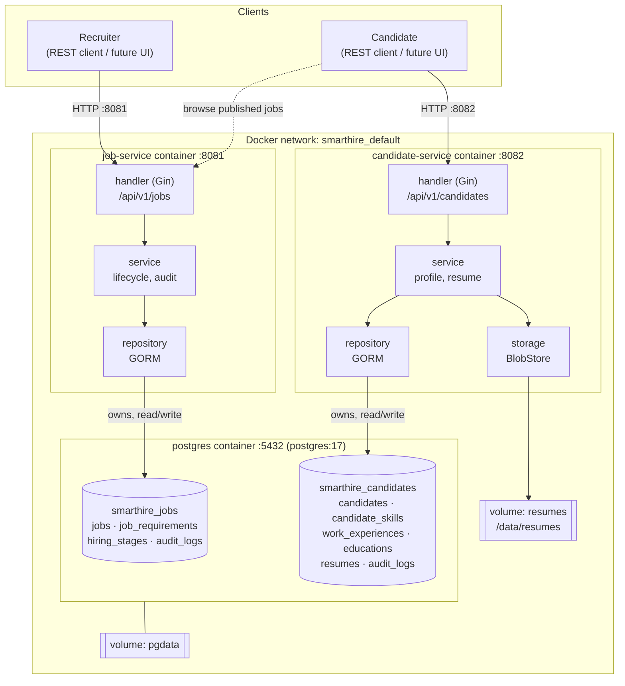
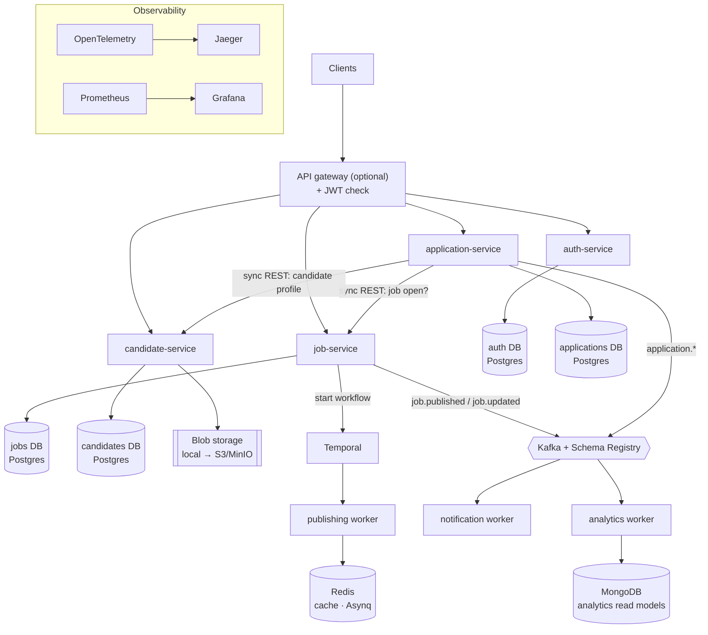
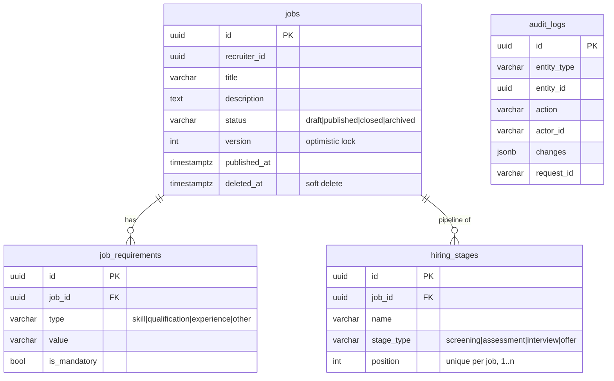
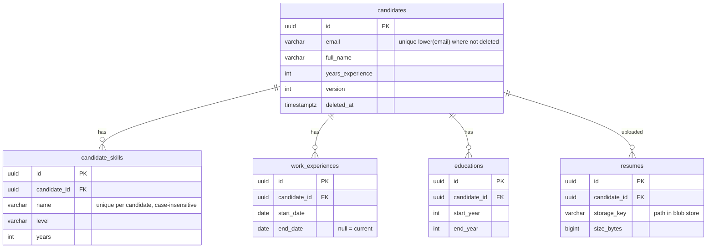

# SmartHire architecture: Week 1

## 1. Services and responsibilities

| Service | Owns | Database | Port |
|---------|------|----------|------|
| job-service | jobs, requirements, hiring stages, job lifecycle, job audit | `smarthire_jobs` | 8081 |
| candidate-service | candidate profile, skills, experience, education, resumes, candidate audit | `smarthire_candidates` | 8082 |

### 1.1 Service layout (Week 1, as deployed by `docker-compose.yml`)



Ownership rules shown above:

- Each service reads and writes **only its own database**. There is no arrow from job-service to `smarthire_candidates` or the other way round.
- The two services **do not call each other** in Week 1. Cross-service needs start in Week 2 (see §8).
- One Postgres container hosts both databases to save local resources. The databases are still separate. Production would run one instance per service (see ADR 0002).

### 1.2 Target layout (end of Week 3, planned)



Every service keeps its own database. Data from other services arrives only through REST calls or events, never by querying another service's tables.

Planned additions:

- **application-service** (Week 2): candidate applications, duplicate and eligibility rules, application tracking. It needs data from both services above. It will get that data through APIs or events, never through their databases.
- **publishing worker** (Week 2): Temporal worker that runs the job publishing workflow.
- **notification and analytics workers** (Week 3): Kafka consumers.

## 2. Inside a service

```
HTTP request
   │
   ▼
middleware: RequestID → Logger → Recovery
   │
   ▼
handler   (Gin) parse path/query, bind + validate JSON DTO, map to service input
   │
   ▼
service   business rules, state machine, cross-field validation,
          opens a DB transaction, writes the change + audit row together
   │
   ▼
repository (GORM) SQL, optimistic locking, preloads, error mapping
   │
   ▼
PostgreSQL
```

Rules:

- `handler` never touches GORM. `repository` never knows about HTTP.
- `service` depends on the `repository.Repository` **interface**. Unit tests swap in an in-memory fake.
- Errors move up as `pkg/apperr.Error{Kind}`. Only `pkg/httpx` maps a `Kind` to an HTTP status. The same errors can later be reused by Temporal activities and Kafka consumers.
- `internal/` packages cannot be imported from outside their service, so the compiler enforces the service boundary.

## 3. Data model

### smarthire_jobs



### smarthire_candidates



The database enforces the invariants that matter: CHECK constraints (enums, ranges, date order), UNIQUE constraints (email, stage position, skill name) and foreign keys with `ON DELETE CASCADE`. Application validation gives friendly messages. The database is the last line of defence when concurrent requests race.

## 4. Key flows

### 4.1 Create and publish a job

```mermaid
sequenceDiagram
    participant R as Recruiter
    participant H as handler
    participant S as service
    participant DB as Postgres
    R->>H: POST /jobs
    H->>S: CreateJob(input)
    S->>DB: BEGIN; INSERT jobs, requirements, stages; INSERT audit_logs; COMMIT
    H-->>R: 201 {status: draft, version: 1}
    R->>H: PUT /jobs/:id/stages
    S->>DB: BEGIN; DELETE+INSERT stages; version++ ; audit; COMMIT
    R->>H: POST /jobs/:id/publish
    S->>DB: SELECT job + children
    S->>S: CanTransition(draft→published)? PublishProblems() empty?
    S->>DB: UPDATE jobs SET status='published', version=version+1<br/>WHERE id=? AND status='draft' AND version=?
    alt 1 row updated
        S->>DB: INSERT audit_logs; COMMIT
        H-->>R: 200 published
    else 0 rows (someone changed it)
        S->>DB: ROLLBACK
        H-->>R: 409 CONFLICT
    end
```

**Week 2 change:** `publish` sets `processing` and starts a Temporal workflow. The workflow runs these activities in parallel: validate, index, refresh cache, init analytics. Then it sets `published`. If any step fails, the job never reaches `published`, so partial failures cannot corrupt state (PRD §2).

### 4.2 Upload a resume

1. Check that the candidate exists (404 otherwise).
2. Read the first 512 bytes and detect the MIME type from the file bytes (`http.DetectContentType`). Accept only PDF and DOCX (DOCX is detected as ZIP).
3. Stream the file to blob storage through `LimitReader(5 MiB + 1)`, using a temp file and an atomic rename.
4. If the file is over 5 MiB, delete the blob and return 400.
5. In one DB transaction, insert the `resumes` row and an audit row.
6. If the DB step fails, delete the blob. This compensating action means no row ever points to a missing file.

## 5. Consistency and concurrency

| Concern | Mechanism |
|---------|-----------|
| Lost updates (two recruiters edit the same job) | `version` column. `UPDATE … WHERE version = ?`. A mismatch returns 409. |
| Double publish / publish racing an edit | Conditional transition `WHERE status = 'draft' AND version = ?`. Child edits bump `version`. |
| Duplicate candidate emails under concurrent sign-up | Partial unique index on `lower(email)`. No check-then-insert race. |
| Audit trail drifting from data | Audit row is written in the **same transaction** as the change. |
| Half-written uploads | Temp file plus `rename`, which is atomic on POSIX. |
| Slow or hung clients | `ReadHeaderTimeout`, read and write timeouts on `http.Server`. Request body size cap. |
| Deploy / restart | `signal.NotifyContext` plus `Server.Shutdown`: stop accepting new requests, drain in-flight requests, close the DB pool. |

## 6. Cross-cutting

- **Request ID:** `X-Request-ID` is accepted or generated, echoed in the response, written to every log line and audit row. Week 3 adds OpenTelemetry trace context next to it.
- **Logging:** `log/slog` JSON, one line per request (method, route, status, latency, request_id).
- **Health:** `/healthz` reports whether the process is alive (used by the Docker healthcheck). `/readyz` reports whether the DB is reachable (for a load balancer).
- **Config:** env vars only (12-factor). Defaults are set for local dev.

## 7. Assumptions and tradeoffs

- **No auth in Week 1.** `X-User-ID` is trusted as the actor and `recruiter_id` comes from the request body. This is not secure. It will be replaced by JWT claims.
- **Offset pagination.** Simple, but slow on deep pages and can skip or duplicate rows while data changes. Cursor (keyset) pagination on `(created_at, id)` is the upgrade path.
- **`ILIKE` search.** Fine for small data. Large data needs `pg_trgm` GIN indexes or a search engine (the PRD's "search index updates" step in Week 2).
- **Replace-all child endpoints (PUT).** Simple and idempotent. The cost is churn of child IDs. Per-item endpoints can be added if the UI needs them.
- **Single Go module for both services.** Faster to build and share code. The downside is that services cannot pin different dependency versions. See ADR 0001.
- **Local-volume resume storage.** It does not work if the candidate-service runs more than one replica. Swap `storage.BlobStore` for S3/MinIO before scaling out.

## 8. Service-to-service communication (plan)

Week 1 needs none: each service answers only from its own data. From Week 2, the application flow needs to know whether the job is published and what its requirements are (job-service), and the candidate's profile and skills (candidate-service).

| Style | Use for | Safeguards |
|-------|---------|------------|
| Sync REST (internal client in `pkg/`) | reads that must be current, e.g. "is the job still open?" | timeout from the incoming request `context`, retries with backoff for GET only, `X-Request-ID` forwarded, circuit breaker |
| Kafka events (Week 3) | anything that can lag: analytics, notifications, cache, search index | idempotent consumers, Schema Registry for contracts |
| Temporal activities (Week 2) | multi-step flows such as publishing and the application pipeline | automatic retries, durable state |

Once auth exists, internal calls carry a service identity (e.g. a service JWT from the client-credentials flow), so not every container on the network can call internal endpoints.
